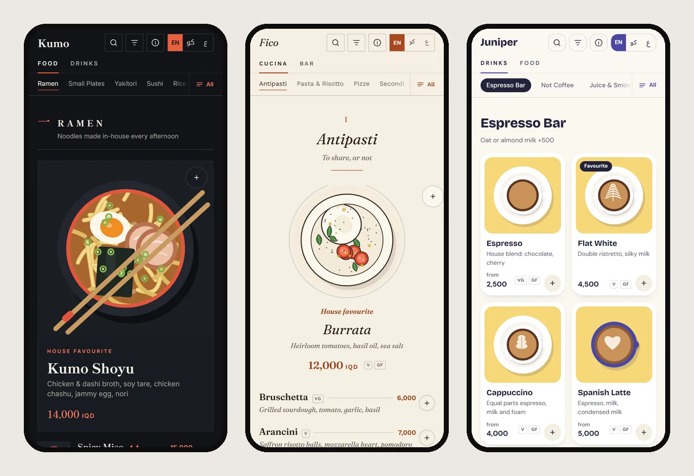
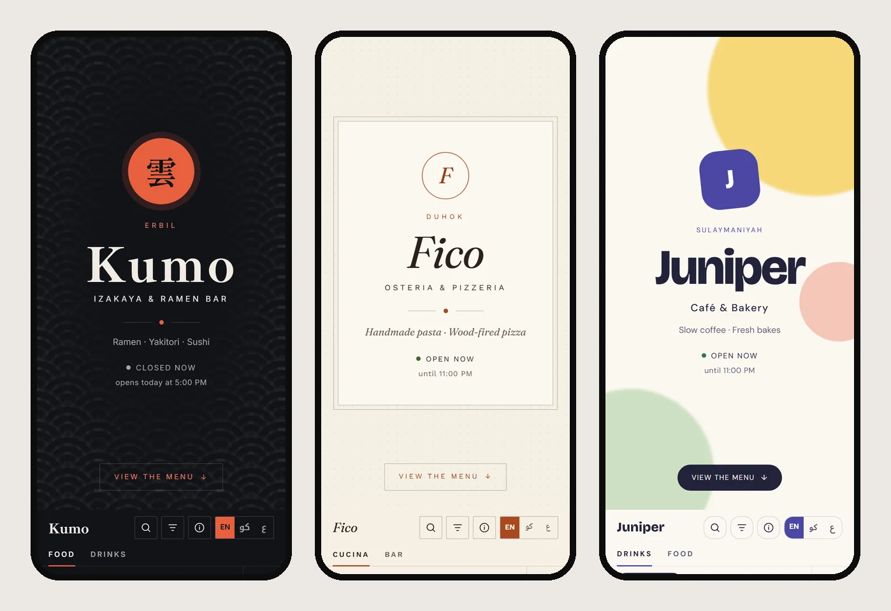
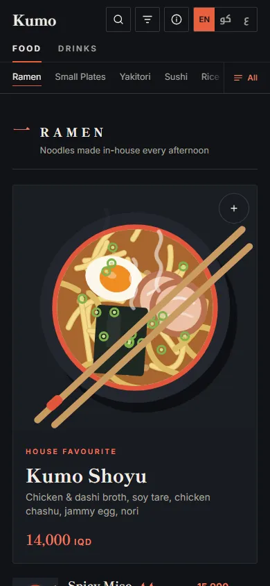
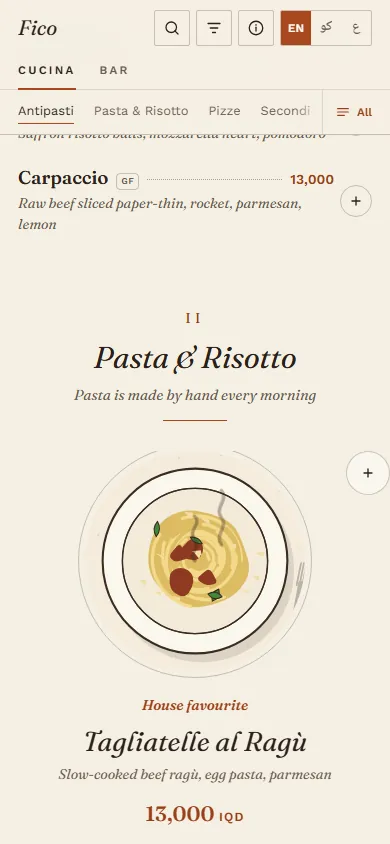
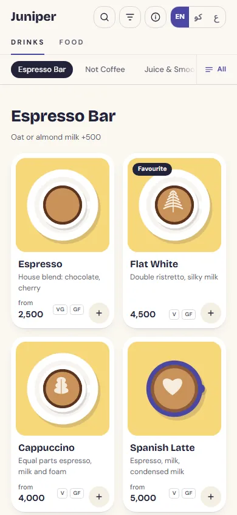
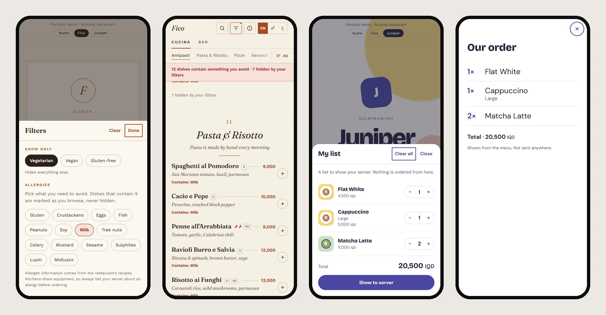
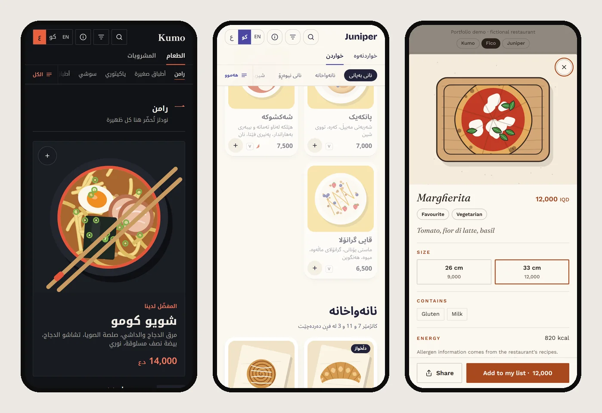

# Carte

**QR menus that look like the restaurant, not the template.**

One menu engine, three fictional restaurants, three completely different menus. Each restaurant is a JSON file and a block of colour tokens. The menus are in English, Kurdish (Sorani) and Arabic with real right-to-left layout, every dish illustration is drawn in the browser from a one-line spec, and the whole thing works offline. There's no framework and no build step.

**[Live demo →](https://omargh99.github.io/carte/)** · [Kumo](https://omargh99.github.io/carte/menu/?b=kumo) · [Fico](https://omargh99.github.io/carte/menu/?b=fico) · [Juniper](https://omargh99.github.io/carte/menu/?b=juniper)



| | Kumo | Fico | Juniper |
|---|---|---|---|
| What | Izakaya & ramen bar, Erbil | Osteria & pizzeria, Duhok | Café & bakery, Sulaymaniyah |
| Layout | `editorial`: a hero dish per chapter, thumbnail rows | `print`: centred heads, dot leaders, text-led | `cards`: an illustrated grid |
| Look | Ink, washi, vermilion, kanji numerals | Warm paper, italic serif, pen-and-ink art | Pastel tiles, rounded, chunky grotesque |
| Shows off | Service past midnight | Sizes with separate prices, closed Mondays | Breakfast and lunch serving windows |



### Every dish plates itself

Open a dish and the illustration builds in the order it was drawn: vessel, broth, each topping landing, then the chopsticks. Each brand animates in its own style. Photo-based menus can't do this; it works because the art is illustrated in code, layer by layer.

| Kumo: set down slowly, steam on hot dishes | Fico: inked like a pen sketch, then coloured | Juniper: bouncy, added dishes fly to the list |
|---|---|---|
|  |  |  |

Each dish plays once per visit, uses only opacity and transform so it stays smooth on cheap phones, and is skipped entirely for anyone with reduced motion turned on.

## Features

- **Three languages, real RTL.** English, Kurdish (Sorani) and Arabic. The stylesheet uses logical properties throughout, so the whole layout mirrors with no RTL overrides. Each brand pairs its Latin typeface with an Arabic-script face that covers the Kurdish letters (ڕ ڵ ێ ۆ ە).
- **Dish art, illustrated in code.** Every dish is a short spec such as `bowl broth:shoyu noodles egg chashu:2 nori`, drawn as SVG in the brand's house style. A restaurant can launch before its photo shoot, and a real photo replaces the drawing later.
- **Allergies and diets.** The EU 14 allergens plus vegetarian, vegan and gluten-free filters. Allergens are *marked, never hidden*, because hiding a dish would imply the rest are safe.
- **A list, not an order.** Guests add dishes with sizes and quantities, see a running total, then switch to a large-type *Show to server* view. There are no accounts and nothing goes over the network.
- **Hours that know the time.** Weekly schedules, closed days and service that runs past midnight, all computed in the restaurant's own timezone. A guest browsing at 1 a.m. sees *opens tomorrow at 5:00 PM*, not just *closed*. Categories can carry a serving window, and they dim outside it.
- **Search in every language at once.** Typing an English dish name into the Arabic menu still finds it. Arabic and Kurdish spelling variants (alef forms, ي/ی, ك/ک, ة/ە, harakat) are folded together.
- **Shareable dishes, working back button.** Every dish has its own URL (`#dish=gyoza`). Open overlays are history entries, so the phone's back gesture closes the sheet instead of leaving the menu.
- **Offline.** A service worker caches the shell, every brand and the fonts. Brand files are fetched network-first so price changes show up on the next visit.
- **Prints itself.** <kbd>Ctrl</kbd>+<kbd>P</kbd> produces a clean two-column A4 card from the same data.
- **Accessible.** Every text colour in every brand passes WCAG AA ([checked by script](tools/check_contrast.mjs)). Dialogs trap focus, <kbd>Esc</kbd> closes them, and reduced-motion preferences are respected.





## Run it

It's static files, so any web server will do:

```sh
python -m http.server 8099
# landing page  http://127.0.0.1:8099/
# the menu      http://127.0.0.1:8099/menu/?b=kumo
```

To deploy on GitHub Pages, push the repo and enable Pages on the `main` branch root. Nothing needs building.

## How it's put together

```
index.html              the landing page, with a live art playground
menu/
  index.html            the menu shell; an inline script picks the brand before first paint
  brands/<id>.json      everything about one restaurant
  css/themes.css        one token block per brand: palette, fonts, radii
  css/menu.css          the engine's styles; reads tokens only, never a colour
  js/app.js             rendering, filters, list, hours, search, history
  js/art.js             the dish illustration renderer
  js/i18n.js            interface strings in en / ku / ar, allergen names
  sw.js                 offline support
tools/
  shot.mjs              drives real Chrome over DevTools for screenshots and smoke tests
  check_contrast.mjs    WCAG AA check for every brand
```

### Adding a restaurant

1. Copy `menu/brands/fico.json` to `menu/brands/<id>.json` and fill it in. `layout` picks `editorial`, `print` or `cards`, and `art` sets the illustration style.
2. Add a token block `:root[data-brand="<id>"] { … }` to `css/themes.css`, then run `node tools/check_contrast.mjs`.
3. Add one line to `window.MENU_BRANDS` in `menu/index.html` with the brand's Google Fonts query.
4. Add the brand file to `SHELL` in `sw.js` and bump `VERSION`.

A dish looks like this:

```json
{
  "id": "margherita",
  "cat": "pizze",
  "name": { "en": "Margherita", "ku": "مارگریتا", "ar": "مارغريتا" },
  "desc": { "en": "Tomato, fior di latte, basil", "ku": "…", "ar": "…" },
  "prices": [
    { "label": { "en": "26 cm" }, "price": 9000 },
    { "label": { "en": "33 cm" }, "price": 12000 }
  ],
  "tags": ["veg", "pick"],
  "allergens": ["gluten", "milk"],
  "kcal": 820,
  "art": "board pizza:basil"
}
```

`tags` accepts `veg`, `vegan`, `gf`, `new`, `pick` (house favourite) and `spicy:1`–`spicy:3`. Use `price` for a single price, or `prices` for sizes.

### The art spec

`vessel layer layer:arg layer:arg:arg …`

The first word is the vessel (`bowl plate dish slate board cup mug glass paper none`). The rest are layers, drawn in order. Some fill the vessel (`broth`, `rice`, `drink`), some take evenly spaced slots around it (`egg`, `chashu`, `lemon`), some scatter (`scallion`, `sesame`, `ice`), and some lay themselves out (`nigiri`, `skewers`, `pizza`). Colours can be named (`broth:miso`) or hex (`drink:#f39a2e`). Placement is seeded from the dish id, so a dish draws the same way on every device.

The same spec reads as a flat woodblock print in Kumo, a pen-and-ink sketch in Fico and flat pastel in Juniper. Try it in the playground on the landing page.

## Checks

```sh
python -m http.server 8099 &
node tools/check_contrast.mjs        # WCAG AA, every brand
node tools/shot.mjs tools/screenshots.json       # every still in screenshots/, plus console errors
node tools/shot.mjs tools/motion.json            # record the animations...
python tools/frames_to_webp.py screenshots/motion/kumo-plating   # ...and stitch each into a WebP
```

---

Kumo, Fico and Juniper are fictional. Names, addresses and phone numbers are placeholders. The Kurdish and Arabic copy was written for this demo.
